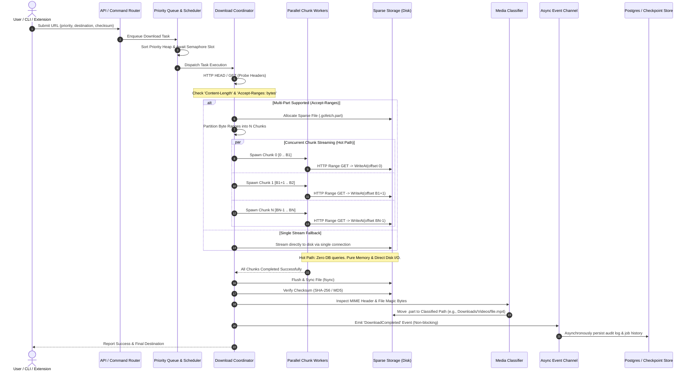

# System Architecture Document — GoFetch

This document outlines the technical architecture, component topology, concurrency model, data flow, invariants, and local IPC/REST interfaces for **GoFetch**, a high-performance cross-platform download manager implemented in Go.

---

## 1. Component Topology

GoFetch is architected as a lightweight, modular system capable of running in two execution models:
1. **CLI Standalone Mode**: A self-contained CLI tool that runs a transient coordinator and downloads directly in-process.
2. **Daemon Mode (v1 Engine / Foundation for v2 GUI & v3 Browser Extension)**: A background service providing local IPC / loopback HTTP endpoints for queuing, monitoring, and controlling downloads.

```
+-------------------------------------------------------------------------+
|                              Client Layer                               |
|                                                                         |
|   +--------------------------+         +----------------------------+   |
|   |  CLI Terminal Interface   |         | Browser Extension / Native |   |
|   |  (Cobra + Bubbletea/TUI) |         | Host Messaging (Post-v1)   |   |
|   +------------+-------------+         +--------------+-------------+   |
+----------------|--------------------------------------|-----------------+
                 |                                      |
                 | (In-process call or Loopback HTTP/UDS)|
                 v                                      v
+-------------------------------------------------------------------------+
|                       GoFetch Engine (Core Daemon)                      |
|                                                                         |
|  +-------------------------------------------------------------------+  |
|  | Local IPC / REST Server (127.0.0.1:12701 or Unix Domain Socket)   |  |
|  +---------------------------------+---------------------------------+  |
|                                    |                                    |
|                                    v                                    |
|  +-------------------------------------------------------------------+  |
|  | Queue & Scheduler (Priority Heap, Concurrency Semaphore)          |  |
|  +---------------------------------+---------------------------------+  |
|                                    |                                    |
|                                    v                                    |
|  +-------------------------------------------------------------------+  |
|  | Download Engine & Worker Pool (HTTP Range, Dynamic Chunking)      |  |
|  +---------------------------------+---------------------------------+  |
|                                    |                                    |
|                                    v                                    |
|  +-------------------------------------------------------------------+  |
|  | Storage & Disk IO (Sparse File Preallocation, Concurrent WriteAt) |  |
|  +---------------------------------+---------------------------------+  |
|                                    |                                    |
|                                    v                                    |
|  +-------------------------------------------------------------------+  |
|  | Media Classifier (MIME Sniffer & Extension Rule Engine)           |  |
|  +-------------------------------------------------------------------+  |
+-------------------------------------------------------------------------+
       |                                                    |
(Async Event Channel)                              (Direct File I/O)
       v                                                    v
+-----------------------------+               +---------------------------+
| State Store & Telemetry     |               | Target Filesystem         |
| - Fast In-Memory State      |               | - Temp: `*.part` (Sparse) |
| - Local Checkpoint (bbolt)  |               | - Final: `Downloads/`     |
| - Off-Hot-Path Postgres Sync|               |   - `Videos/`, `Docs/`,.. |
+-----------------------------+               +---------------------------+
```

### Component Binaries & Runtime Responsibilities

| Component | Runtime Artifact | Ports / IPC | Primary Responsibilities |
| :--- | :--- | :--- | :--- |
| **CLI Client** | `gofetch` | None | Flag parsing, user commands (`add`, `pause`, `list`), interactive TUI rendering via `bubbletea`. |
| **Engine / Daemon** | `gofetch daemon` (or embedded in CLI) | `127.0.0.1:12701` (TCP) or `~/.gofetch/gofetch.sock` (UDS) | Request queueing, chunk scheduler, worker pool, download lifecycle, local REST API. |
| **Chunk Workers** | In-engine goroutines | Dynamic outbound HTTPS | Fetching designated byte ranges (`Range: bytes=X-Y`), streaming into memory buffers. |
| **Storage Engine** | `internal/storage` | Local Filesystem | Pre-allocates sparse files (`os.Truncate`), executes thread-safe non-overlapping `WriteAt` operations, computes SHA-256/MD5. |
| **Media Classifier** | `internal/classifier` | Local Filesystem | Detects content types via magic byte sniffing and extension mappings; atomically moves files (`os.Rename`) to sorted subfolders. |
| **State Synchronizer** | `internal/state` | Optional external DB (Postgres) / Embedded bbolt | Asynchronously persists job states, audit logs, and download statistics completely off the critical hot path. |

---

## 2. Data Flow Diagram

The following Mermaid sequence diagram illustrates the lifecycle of a download request, chunk distribution, parallel disk writes, media classification, and out-of-band asynchronous state synchronization.



---

## 3. Packages Used to Implement this Project

### Go Standard Library
* **`net/http`**: High-performance HTTP client, persistent connection pooling (`Transport.MaxIdleConnsPerHost`), timeout handling, and partial range request header injection.
* **`os` & `io`**: File operations, sparse allocation (`os.File.Truncate`), random-access concurrent disk writes via `io.WriterAt` / `os.File.WriteAt`, and atomic moves via `os.Rename`.
* **`sync` & `sync/atomic`**: Mutex locks for state coordinators, lock-free 64-bit atomic counters (`atomic.Int64`) for high-frequency progress and byte-rate metrics.
* **`context`**: Cancellation and pause signal propagation across goroutine pools and active HTTP request bodies.
* **`container/heap`**: Minimum/maximum priority heap for queue reordering and starvation-free task scheduling.
* **`crypto/sha256` & `crypto/md5`**: Streaming cryptographic hash computation directly from file readers.
* **`mime` & `path/filepath`**: Extension resolution and standard MIME table lookup.

### Third-Party Go Packages
* **CLI & Terminal UX**:
  * `github.com/spf13/cobra`: Standard POSIX command hierarchy (`add`, `pause`, `resume`, `list`, `daemon`).
  * `github.com/spf13/pflag`: Flag parsing compliant with Unix standard flags.
  * `github.com/charmbracelet/bubbles` & `github.com/charmbracelet/bubbletea`: State-driven terminal UI framework for real-time multi-chunk progress bars.
  * `github.com/charmbracelet/lipgloss`: Terminal styling and layout definitions.
* **Configuration Management**:
  * `gopkg.in/yaml.v3`: Parsing and serialization of user configuration files (`config.yaml`).
* **Concurrency & Coordination**:
  * `golang.org/x/sync/errgroup`: Structured goroutine lifecycle management with fail-fast cancellation for chunk worker sets.
* **Local State & Recovery**:
  * `go.etcd.io/bbolt`: Low-overhead embedded ACID key-value store for storing chunk progress checkpoints without requiring an external database.
* **Local HTTP Routing (Daemon API)**:
  * `github.com/go-chi/chi/v5`: Lightweight, zero-allocation HTTP router for daemon RPC and loopback client communication.
* **Database Driver (Off-Hot-Path Telemetry)**:
  * `github.com/jackc/pgx/v5`: High-performance PostgreSQL driver and connection pool, isolated strictly behind an asynchronous event channel.

---

## 4. Invariants (Rules That Must Never Be Broken)

1. **Postgres & External Databases Must NEVER Be on the Critical Hot Path**:
   * The hot path consists of HTTP reading, chunk memory buffering, and `WriteAt` disk operations.
   * Under no circumstances may a chunk worker perform a synchronous database transaction, query, or network RPC during byte transfer.
   * Any persistence to PostgreSQL or external backends must be pushed over a buffered Go channel (`chan Event`, non-blocking drop-or-buffer) to an asynchronous worker pool.
2. **Deterministic Chunk Isolation & Non-Overlapping Offsets**:
   * Each chunk worker is assigned a closed byte range: `[start_offset, end_offset]`.
   * Workers must write exclusively to their assigned offset using random-access writes (`os.File.WriteAt`).
   * Workers must never share write cursors, append to a shared pointer, or overwrite adjacent chunk boundaries.
3. **Atomic File Commitment**:
   * Files in transit must use the temporary suffix `.gofetch.part`.
   * An incomplete download must never be written directly into the destination folder under its target name.
   * Files are moved into their final destination directory exclusively via `os.Rename` after 100% completion and optional checksum verification.
4. **Resumability & Clean Halt**:
   * When paused or canceled (via context cancellation or `SIGINT`), chunk workers must immediately terminate upstream HTTP streams.
   * The storage layer must flush pending OS buffers (`fsync`) and record completed byte offsets in the local checkpoint log before process exit.
5. **Dynamic Fallback on Non-Compliant Servers**:
   * If an endpoint returns `200 OK` (full body) instead of `206 Partial Content` in response to a `Range` header, or omits `Accept-Ranges: bytes`, the engine must safely drop multi-chunk partitioning and download the payload as a single continuous stream without corrupting files.
6. **Path Traversal & Shell Injection Sanitization**:
   * Filenames extracted from URLs or HTTP `Content-Disposition` headers must be stripped of directory separators (`/`, `\`), null bytes, and traversal tokens (`..`).
   * Target destination folders must be resolved to absolute paths before file creation.
7. **Priority Invariant**:
   * When concurrency limits (`--max-concurrent`) throttle task execution, available worker slots must always be granted to the highest priority task (`PriorityHigh > PriorityNormal > PriorityLow`).

---

## 5. Public API Endpoints (Local IPC / Daemon)

When running in daemon mode, GoFetch binds to `127.0.0.1:12701` (or local Unix Domain Socket) to service CLI commands and future browser extensions / GUI applications.

### 5.1 Enqueue Download
* **Method & Path**: `POST /api/v1/downloads`
* **Description**: Enqueues a new download job.
* **Request JSON**:
```json
{
  "url": "https://example.com/files/archive.iso",
  "destination_dir": "/home/user/Downloads",
  "priority": "high",
  "max_chunks": 8,
  "checksum": "e3b0c44298fc1c149afbf4c8996fb92427ae41e4649b934ca495991b7852b855",
  "checksum_algo": "sha256",
  "auto_classify": true
}
```
* **Response JSON (`202 Accepted`)**:
```json
{
  "id": "f47ac10b-58cc-4372-a567-0e02b2c3d479",
  "url": "https://example.com/files/archive.iso",
  "file_name": "archive.iso",
  "status": "queued",
  "priority": "high",
  "created_at": "2026-11-02T13:00:00Z"
}
```

---

### 5.2 List Active & Queued Downloads
* **Method & Path**: `GET /api/v1/downloads?status=downloading`
* **Description**: Retrieves a paginated list of downloads filtered by status (`queued`, `downloading`, `paused`, `completed`, `failed`).
* **Response JSON (`200 OK`)**:
```json
{
  "items": [
    {
      "id": "f47ac10b-58cc-4372-a567-0e02b2c3d479",
      "url": "https://example.com/files/archive.iso",
      "file_name": "archive.iso",
      "status": "downloading",
      "priority": "high",
      "total_bytes": 1073741824,
      "downloaded_bytes": 429496729,
      "progress_percent": 40.0,
      "speed_bps": 15482000,
      "eta_seconds": 41,
      "category": "Archives"
    }
  ],
  "total": 1
}
```

---

### 5.3 Get Detailed Download Status
* **Method & Path**: `GET /api/v1/downloads/{id}`
* **Description**: Returns granular task status including individual chunk boundaries and progress.
* **Response JSON (`200 OK`)**:
```json
{
  "id": "f47ac10b-58cc-4372-a567-0e02b2c3d479",
  "url": "https://example.com/files/archive.iso",
  "file_name": "archive.iso",
  "target_path": "/home/user/Downloads/Archives/archive.iso",
  "status": "downloading",
  "priority": "high",
  "total_bytes": 1073741824,
  "downloaded_bytes": 429496729,
  "speed_bps": 15482000,
  "eta_seconds": 41,
  "category": "Archives",
  "chunks": [
    {
      "chunk_index": 0,
      "start_byte": 0,
      "end_byte": 268435455,
      "downloaded_bytes": 268435455,
      "completed": true
    },
    {
      "chunk_index": 1,
      "start_byte": 268435456,
      "end_byte": 536870911,
      "downloaded_bytes": 161061274,
      "completed": false
    }
  ]
}
```

---

### 5.4 Pause Download
* **Method & Path**: `POST /api/v1/downloads/{id}/pause`
* **Description**: Pauses active download and flushes byte checkpoints to disk.
* **Response JSON (`200 OK`)**:
```json
{
  "id": "f47ac10b-58cc-4372-a567-0e02b2c3d479",
  "status": "paused"
}
```

---

### 5.5 Resume Download
* **Method & Path**: `POST /api/v1/downloads/{id}/resume`
* **Description**: Resumes a paused or interrupted download from recorded chunk checkpoints.
* **Response JSON (`200 OK`)**:
```json
{
  "id": "f47ac10b-58cc-4372-a567-0e02b2c3d479",
  "status": "resumed"
}
```

---

### 5.6 Delete / Cancel Download
* **Method & Path**: `DELETE /api/v1/downloads/{id}?delete_files=true`
* **Description**: Cancels the task, removes it from queue, and optionally purges temporary `.part` files.
* **Response JSON (`200 OK`)**:
```json
{
  "id": "f47ac10b-58cc-4372-a567-0e02b2c3d479",
  "status": "deleted",
  "files_purged": true
}
```

---

### 5.7 System Health & Telemetry
* **Method & Path**: `GET /api/v1/system/stats`
* **Description**: High-level engine performance metrics.
* **Response JSON (`200 OK`)**:
```json
{
  "active_downloads": 2,
  "queued_downloads": 5,
  "total_speed_bps": 32500000,
  "open_connections": 16,
  "memory_allocated_bytes": 48234496,
  "uptime_seconds": 3600
}
```
